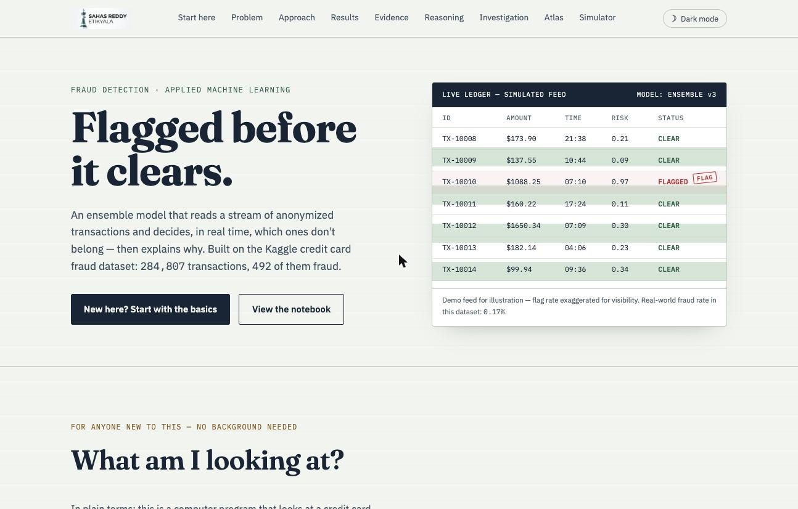

# Fraud Detection Case File

A one-page write-up of a credit card fraud detection project. It explains the problem for someone with no background, walks through the approach, and has a small simulated transaction feed.



**Live site:** https://sahasreddye-sys.github.io/fraud-detector/


## About the project

The data is the Kaggle credit card fraud dataset: 284,807 transactions, 492 of them fraud (about 0.17%). Because fraud is so rare, the write-up focuses on class imbalance and why accuracy is a bad metric here.

The ledger at the top of the page is a simulated demo feed. The fraud rate in it is exaggerated so flagged rows show up.

## Files

- `index.html`: the page
- `fraud_detection.ipynb` and `fraud_detection.py`: the modeling code

## Run it locally

The site has no build step.

```bash
git clone https://github.com/sahasreddye-sys/fraud-detector.git
cd fraud-detector
python -m http.server 8000
```

Then open http://localhost:8000.

## License

MIT, see `LICENSE`.
# Fraud Detection — Case File Site

A single-page portfolio site for the credit card fraud detection project. Pure HTML/CSS/JS,
no build step, no external runtime dependencies besides Google Fonts.

## Before you publish this

Several numbers on the page are **placeholders** standing in for your actual notebook
results. Search the files for these and swap in your real numbers:

- `index.html` → the four `data-target="…"` values in the `#results` section (PR-AUC,
  ROC-AUC, recall, precision)
- `index.html` → the bar widths/values in the model-comparison chart (`#results` section,
  the `<svg class="chart-svg">` with the five `.compare-row` groups)
- `index.html` → the `#evidence` gallery captions and the confusion-matrix numbers
- `index.html` → the two `id="repo-link"` / `id="repo-link-2"` anchors — point these at
  your actual GitHub repo URL

Everything else (copy, layout, the live ledger demo) is ready as-is.

## Deploying to GitHub Pages

1. Create a new GitHub repo (or use an existing one) and push these files to it,
   keeping this folder structure at the repo root:
   ```
   index.html
   css/style.css
   js/script.js
   .nojekyll
   ```
2. On GitHub: **Settings → Pages → Source** → choose the branch (usually `main`) and
   `/ (root)` as the folder → Save.
3. Wait 1-2 minutes, then visit `https://<your-username>.github.io/<repo-name>/`.

Notes:
- All asset paths in `index.html` are relative (`css/style.css`, not `/css/style.css`),
  which is what makes this work whether the site lives at the root of
  `username.github.io` or under a project subpath like
  `username.github.io/repo-name/`. Don't add a leading slash to these if you edit them.
- `.nojekyll` tells GitHub Pages to skip Jekyll processing, which isn't needed here but
  avoids edge cases with how some files get served.
- No build step, no `node_modules`, no bundler — just static files.
